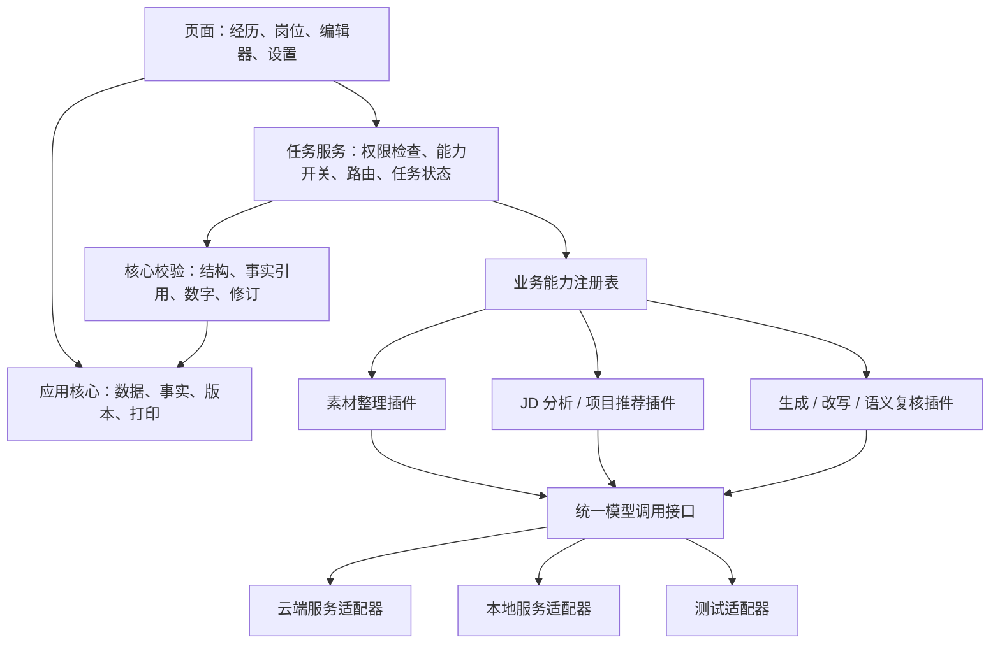

# AI 可插拔架构设计

日期：2026-10-28
状态：完整架构仍属后续设计；交互原型已实现精简的适配器注册、能力开关和绑定示范，真实模型尚未接入。
适用范围：个人使用的产品、运营、业务岗位简历管理系统。

当前原型对应代码为 [ai.js](../prototype/src/ai.js)：提供两个本地演示适配器，支持 `project.match`、`resume.rewrite`，统一通过 `runCapability` 路由，并支持取消和全局/单项开关。业务 UI 不直接绑定某个供应商。该文件仅用于验证接口边界和交互；下文所述任务持久化、服务端密钥、真实协议适配、结果校验与完整业务插件注册表尚未实现。

## 1. 可插拔的具体含义

将可插拔拆成三个独立维度，避免只把模型名称做成一个下拉框。

| 维度 | 用户可以做什么 | 实现边界 |
| --- | --- | --- |
| 模型服务 | 更换连接、服务商或本地模型；保留同一套业务页面 | Provider Adapter 负责不同协议和错误转换 |
| 业务能力 | 分别开启或关闭素材整理、JD 分析、项目推荐、简历生成、局部改写、语义复核 | Capability Plugin 负责一项业务任务 |
| 路由配置 | 为不同能力绑定不同连接与模型 | Capability Binding 独立于业务数据保存 |

新增服务协议或业务能力，需要实现并注册模块；切换已注册模块的设置不需要修改页面代码。首版使用代码注册表与配置切换，模块随应用版本交付，不提供任意代码上传、插件市场或运行中加载未知脚本。

整套 AI 关闭、未配置或不可用时，仍能维护经历、手工整理 JD、选择项目、编辑简历、保存版本、备份和导出。人工模式不调用模型，也不把规则筛选包装成 AI 推荐。

## 2. 分层与依赖



依赖规则：

- 资料、版本和打印模块不导入模型 SDK，也不要求存在 API 密钥。
- UI 只调用统一任务服务，不直接请求模型服务，不读取密钥。
- 能力插件接收当前任务所需的数据快照，通过模型接口获得候选结果；不直接写入数据库或接触密钥。
- Provider Adapter 只处理模型协议、能力声明、超时取消、响应和用量；不了解简历数据库和页面。
- 事实引用、数值规则、不可变版本和人工确认属于核心逻辑，不能随 AI 插件关闭。
- 可选的“语义复核”只提供额外提示，不代替核心校验或用户审核。

## 3. 首批业务能力

| 能力 ID | 设置页名称 | 输入 → 输出 | 关闭后的操作 |
| --- | --- | --- | --- |
| source.extract | 整理项目素材 | 原始文本 → 项目与事实候选 | 手工新增项目、粘贴原文、标记事实 |
| job.parse | 分析岗位要求 | JD 原文 → 带原文引用的要求列表 | 保存 JD 并手工标注要求 |
| project.match | 推荐项目 | 岗位要求、事实摘要、篇幅 → 组合及证据关系 | 搜索、筛选和手动选择项目 |
| resume.draft | 生成简历草稿 | 选定事实、档案、模板约束 → 带来源的段落候选 | 将用户选定的原文加入模板 |
| bullet.rewrite | 改写单条描述 | 原句、事实、目标要求 → 改写建议 | 直接编辑文字 |
| semantic.review | 语义复核 | 草稿及事实 → 需要人工复核的提示 | 保留核心校验，用户并排检查原文 |

能力之间通过已保存的数据契约衔接，不直接调用彼此。例如，关闭 JD 分析后，用户手工填写的岗位要求仍可交给项目推荐；关闭整份生成后，手工草稿仍能使用局部改写。

第一版实施时，按源材料整理、JD 分析、项目推荐、整份生成、局部改写依次接入；语义复核可在同一接口下后置，但默认不应显示为已实现。

## 4. 接口契约示意

以下用于明确边界，完整输入输出类型在对应功能实施时定义。

```ts
type CapabilityId =
  | 'source.extract'
  | 'job.parse'
  | 'project.match'
  | 'resume.draft'
  | 'bullet.rewrite'
  | 'semantic.review';

type ModelCapabilities = {
  structuredOutput: 'json-schema' | 'json' | 'text';
  streaming: boolean;
  cancellation: 'remote-and-local' | 'local-only';
  reportsUsage: boolean;
  contextWindow?: number;
};

interface ProviderAdapter {
  id: string;
  version: string;
  probe(config: ConnectionConfig, signal: AbortSignal): Promise<ProbeResult>;
  describeModel(config: ConnectionConfig, model: string): Promise<ModelCapabilities>;
  generate(request: ModelRequest, context: ProviderContext): Promise<ModelResponse>;
}

interface CapabilityPlugin<K extends CapabilityId> {
  id: string;
  version: string;
  capability: K;
  inputSchemaVersion: string;
  outputSchemaVersion: string;
  requiredModelFeatures: RequiredModelFeatures;
  execute(input: InputOf<K>, context: CapabilityContext): Promise<OutputOf<K>>;
}

interface CapabilityContext {
  model: ModelClient;
  signal: AbortSignal;
  taskId: string;
  inputRevision: string;
  promptVersion: string;
}
```

`InputOf<K>` 和 `OutputOf<K>` 由统一任务类型表映射，并绑定运行时结构校验器。TypeScript 类型不能替代模型输出的运行时验证。

`ProviderContext` 的密钥解析只在服务端发生；能力插件得到的 `ModelClient` 是受限调用接口。`ModelResponse` 统一返回文本或解析候选、结束原因、用量和服务端请求标识；拒绝、内容截断、网络失败和结构错误不得被当作成功内容。

无原生结构化输出的模型只有在该能力明确允许时，才使用“文本 → JSON 解析 → 结构验证”的路径；不能把模型的 JSON 模式等同于已满足输出契约。能力不足时显示“不支持”，不静默降级。

## 5. 注册、配置与切换

### 5.1 注册表

应用启动时注册已安装的 Provider Adapter 和 Capability Plugin，校验唯一 ID、版本与契约兼容性。业务功能从注册表解析插件，不在页面代码中按服务商写分支。

第一版先实现一个真实服务协议适配器和一个测试适配器。用第二个适配器或第二个同协议连接做扩展演练；未验证的服务不能显示“支持”。本地模型和各云端服务的协议兼容性需逐个测试，不能只靠地址替换推断。

### 5.2 配置数据

| 配置实体 | 关键字段 |
| --- | --- |
| AISettings | 全局开关、默认连接、配置修订号、关闭任务的策略 |
| ProviderConnection | 连接 ID、显示名、适配器 ID、服务地址、密钥引用、启用状态、最近连接检查 |
| ModelProfile | 连接 ID、模型标识、已验证能力、生成参数、配置修订 |
| CapabilityBinding | 能力 ID、启用状态、插件 ID/版本、模型配置 ID、超时、重试策略 |

密钥与以上业务配置分开。备份导出保留连接说明和模型绑定，但不包含密钥；恢复后显示“需要重新配置凭据”。空白或掩码值不得覆盖已有密钥，使用明确的“替换密钥”和“移除密钥”操作。

### 5.3 切换规则

- 保存设置成功后，新任务使用新配置；已有结果保留其原始模型和输入记录。
- 每个运行任务固定配置快照，执行途中不随默认模型切换而改变。
- 停用连接、关闭能力或关闭全部 AI 时，阻止新调用，取消相关在途任务；取消失败或晚到的结果也不能写回草稿。
- 已发出的请求无法撤回已发送的数据；本地取消保证结果不会再应用，远端是否停止取决于服务能力。
- 重新启用只允许后续任务使用，不自动重试旧任务或重写简历。
- 默认不自动换到另一家服务。未来如提供备用路由，需由用户配置明确的连接名单和触发条件。

## 6. 任务执行与一致性

统一执行顺序：

1. 校验全局开关、能力开关、模块注册状态和所需输入。
2. 解析绑定，检查连接和模型能力；创建带配置与输入快照的任务。
3. 计算结果复用键，命中也要检查当前功能是否允许使用；不能在 AI 已关闭时触发后台补算。
4. 调用插件，由适配器访问模型；核心任务服务负责次数、超时和重试总预算。
5. 校验输出结构、事实引用、指标口径和输入修订，拒绝无效引用或不完整输出。
6. 检查任务仍有效、功能未被关闭、草稿基线未改变；生成候选建议。
7. 用户接受候选后才更新草稿；保存版本是独立操作。

复用键至少包含输入哈希、数据修订、能力 ID、插件版本、模型连接和配置修订、提示词版本、输出契约版本及篇幅约束。缓存属于任务结果，不直接覆盖草稿。

使用任务 ID、幂等键和草稿修订号避免重复点击和旧结果覆盖。用户编辑过内容后，旧任务即使成功，也只能作为待比较候选。

暂时网络失败最多重试 2 次，结构修复最多 1 次，并共享一个总调用预算；适配器 SDK 的隐式重试关闭或计入预算，避免多层重试叠加。

状态建议：`queued / running / validating / awaiting-review / completed / failed / cancelled / interrupted / stale`。未配置、能力关闭和模型不支持是运行前的可用性状态，不能伪造为任务执行成功。

日志保留适配器、插件、模型标识、配置修订、用量、耗时、状态和错误类型，默认不写入完整简历、JD 正文或密钥。

## 7. UI 与能力可用性

服务端提供统一能力状态，页面不自行猜测环境变量或模型是否可用。

| 状态 | 页面文案 | 用户可以继续做什么 |
| --- | --- | --- |
| 全局关闭 | AI 已关闭，你可以手工完成 | 录入、选材、编辑、保存、导出 |
| 某项关闭 | 该功能已关闭 | 使用对应人工入口，或前往设置 |
| 未配置 | 配置模型后可使用 AI | 保留已输入内容，继续人工流程 |
| 模型不支持 | 当前模型不支持此功能 | 切换到已验证模型，或人工处理 |
| 运行中 | 正在分析岗位要求… | 取消当前任务，不锁住其他页面 |
| 请求失败 | 生成未完成，已保留你的内容 | 重试、查看简短原因或手工继续 |
| 等待审核 | 改写建议已生成 | 查看依据、采用、修改或丢弃 |

设置页分成“使用 AI”“模型连接”“功能分配”三部分。普通操作使用通俗名称；协议地址、超时和参数放到高级设置中。

在全局 AI 关闭时，保存连接配置不会联网；连接检查按钮说明需先开启 AI。模型列表刷新和探针也视为 AI 网络行为，不应由页面后台自动触发。

## 8. API 与目录边界

建议 API：

- `GET /api/ai/capabilities`：返回各能力可用性和原因，不返回密钥。
- `GET/PATCH /api/settings/ai`：读取和修改设置，使用配置修订控制并发写入。
- `POST /api/ai/connections/:id/probe`：用户主动连接检查，仅发送最小测试内容。
- `POST /api/ai/tasks`：按能力 ID 提交任务，携带幂等键和输入修订。
- `GET /api/ai/tasks/:id`：读取状态、候选结果或错误。
- `POST /api/ai/tasks/:id/cancel`：取消并递增有效性标记，禁止后到结果写回。

这些接口属于规划，路径可随开发细化。普通资料、版本和打印 API 独立于 `/api/ai`。

```text
src/domain/                    事实、项目、JD、简历类型与规则
src/server/core/               数据保存、版本、引用检查
src/server/ai/contracts/       能力及模型输入输出契约
src/server/ai/registry/        插件与适配器注册
src/server/ai/capabilities/    六项业务能力的实现
src/server/ai/providers/       服务协议适配器
src/server/ai/runtime/         路由、任务、缓存、取消、用量
src/server/settings/           设置、密钥引用、配置修订
src/features/ai-settings/      连接与功能分配页面
tests/ai-contracts/            适配器和业务插件契约测试
```

## 9. 验收与落地顺序

必须验证的结果：

1. 清空模型配置、关闭 AI，完整走通手工录入、组装、保存和导出，模型请求次数为零。
2. 将 JD 分析和局部改写绑定到不同模型配置，页面流程与数据结构不变。
3. 关闭项目推荐后仍可手工选择项目，再使用简历生成。
4. 关闭 JD 分析后，人工整理的要求仍可供项目推荐使用。
5. 通过注册另一个适配器完成扩展演练，不修改资料、版本或打印模块。
6. 不支持结构化输出的模型受到明确校验，无效结果不会进入已确认事实或正式版本。
7. 运行中关闭 AI、取消任务或修改草稿后，旧结果不能覆盖当前内容。
8. 更换模型或插件版本后，缓存正确失效，旧简历仍可查看和导出。
9. 网络错误、服务拒绝、输出截断、配置错误和重复请求得到各自正确处理。
10. 备份及浏览器响应不包含密钥；开发测试适配器的数据明确标记，不混入真实资料。

先实现人工主流程与契约，再接入测试适配器、首个真实适配器、各项业务能力，最后做替换和关闭的回归测试。接口可插拔、设置可切换与接入多家真实服务分别验收，不将模拟测试等同于真实服务接入完成。
