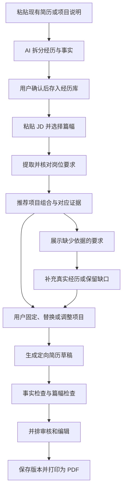

# AI 简历管理系统：产品与实施规划

更新日期：2026-10-28
阶段：已完成产品规划，并制作基于用户截图的本地交互原型；真实数据存储和模型服务尚未接入。

补充设计：[AI 可插拔架构](AI可插拔架构设计.md)、[UI 与交互设计](UI与交互设计.md)。2026-10-28 根据用户要求增加模型服务适配、业务能力开关、按功能分配模型与三套 UI 视觉方向。

## 1. 目标与已确认范围

用户已有较多项目经历，希望根据不同 JD 快速选取项目、调整表达，减少重复修改简历的时间。

已确认：

- 使用对象：先给自己使用。
- 求职方向：产品、运营、业务岗位。
- 核心任务：维护完整经历库，按岗位生成可以审核、编辑、导出的简历版本。
- AI 采用可插拔模式；更换模型或关闭 AI 不影响手工主流程。
- 开发前同步设计具体 UI，先确定视觉方向与交互规格。
- UI 定位已进一步明确：左侧对话、右侧持续显示可编辑简历；项目素材与 JD 按需展开。两轮概念稿未获认可，现依据用户提供的截图制作原型，见 [原型说明](../prototype/README.md)。

规划采用的默认值：中文、电脑浏览器、本机运行；以一页简历为默认，可切换两页；项目数量由篇幅和内容决定，默认推荐 2～3 个。以上是可修改的产品默认值。

第一版的交付目标：录入一次完整经历后，能够完成“粘贴 JD → 审核岗位要求 → 确认项目组合 → 审核改写 → 导出并保留版本”的全过程。

验收时，以已有经历库为前提，争取将单份简历的选材和修改时间降到 5～10 分钟，并较手工流程减少至少一半。这是待真实使用验证的目标，不是已经实现的效果，也不包含首次整理素材的时间。

## 2. 用户流程



首次使用：填写基础资料，粘贴已有简历及项目说明，确认 AI 拆分结果。素材不完整时允许先保存，后续按需要补充。

日常投递：输入公司、岗位、JD 原文及篇幅偏好；检查提取的要求；选择推荐项目；审核生成结果；保存一个与该岗位关联的版本。

同类岗位复用：复制一个已有版本，关联新 JD，重新检查匹配关系；人工修改过的内容默认保留，重新生成前展示影响范围。

## 3. 第一版范围

| 模块 | 第一版交付 | 后续增强 |
| --- | --- | --- |
| 基础档案 | 联系方式、教育、工作经历、技能、证书；均可手工维护 | 中英文档案、多个求职身份 |
| 经历导入 | 粘贴文本、TXT/Markdown 批量导入；拆分为项目后逐项确认 | DOCX、文本型 PDF；更晚再考虑扫描件 OCR |
| 项目经历库 | 新增、编辑、归档；业务场景和能力标签；事实来源；缺失字段提示 | 从工作笔记整理经历、重复内容合并 |
| 岗位库 | 保存 JD 原文和链接、公司、岗位、分析结果 | 浏览器采集、相似岗位聚类 |
| JD 分析 | 职责、核心能力、加分项、资格条件；均可修正 | 岗位画像和行业术语积累 |
| 项目推荐 | 推荐组合、理由、覆盖要求、缺口；固定和替换项目 | 根据使用反馈调整偏好 |
| 简历编辑 | 单栏中文模板、项目排序、逐条改写、事实引用、手工编辑 | 多模板、英文简历、更多局部编辑能力 |
| 导出与版本 | 浏览器打印为 PDF；保存版本、复制版本、对比文字变化 | 一键下载 PDF、DOCX 导出 |
| 设置和备份 | AI 总开关、能力开关、按功能绑定模型、连接检查、完整备份和恢复 | 云端同步、多设备使用 |

多人账号、付费订阅、招聘平台自动投递、面试训练和完整投递 CRM 不进入第一版。未来需要向公网或多人开放时，另行设计身份认证、权限和部署方案。

## 4. 经历库：记录可复用的事实

### 4.1 项目字段

| 字段 | 内容 | 录入要求 |
| --- | --- | --- |
| 项目名称与时间 | 名称、起止时间、所属公司或工作经历 | 名称必填；时间可待补充 |
| 业务背景 | 业务场景、目标用户、所处阶段 | 建议填写 |
| 业务问题与目标 | 当时要解决什么，如何定义成功 | 建议填写 |
| 个人职责 | 负责、主导、参与的具体范围 | 进入 AI 生成前必须确认 |
| 具体行动 | 调研、分析、方案、执行、协作、复盘等 | 至少一条确认过的事实 |
| 判断与取舍 | 为什么采用该方案，约束是什么 | 选填，但有助于产品岗位表达 |
| 结果与影响 | 用户、效率、增长、收入、成本、交付等变化 | 可为定性结果，不强制编造数字 |
| 指标口径 | 指标定义、基线、结果、时间窗、统计范围、归因限制 | 使用量化结果时填写已知部分 |
| 合作与资源 | 相关团队、个人协调范围、预算或资源约束 | 选填 |
| 能力与场景标签 | 用户洞察、产品规划、增长、活动、商业分析等 | AI 建议，用户可修改 |
| 原始材料 | 原文、来源说明、用户补充内容 | 保留来源和修订记录 |
| 可对外使用范围 | 可写入简历的名称、数字或脱敏表达 | 默认由用户编辑确认 |

一个项目可以对应多个方向，但只维护一份事实基础；不同岗位的表达保存在各自简历版本中。

### 4.2 事实条目与指标

将长篇项目材料拆为可引用的事实条目，每条记录事实 ID、原文片段、来源版本、事实类型和确认状态。状态包括“待确认、用户已确认、存在冲突”。用户确认代表本人认可，不表示系统独立核验了真实性。

重点区分：

- 团队总体结果与个人实际贡献。
- 目标值与实际完成值。
- 同比、环比、百分比与百分点。
- 活动期间出现的变化与有证据支持的因果关系。
- 实验、实习、课程项目和正式业务项目。

例如，原材料只写“参与活动复盘”，生成内容应保留参与范围；原材料没有转化率数字时，可描述分析和复盘工作，并在编辑区提示补充数据。待补充提示不会写入正式简历。

初次导入时最多集中询问 3 个最影响表达的问题。针对某个 JD 生成时，再优先追问被选中项目的缺口，减少一次性整理负担。

### 4.3 工作经历与项目去重

项目可关联到一段工作经历。默认由工作经历概括职责和长期成果，由项目展示具体案例。同一成果若已在工作经历中展开，项目区减少重复，编辑器提示重复描述。

技能摘要仅使用已确认的技能或有经历支撑的能力；基础信息、公司名称、学历和任职时间直接读取用户资料。

## 5. JD 分析与项目推荐

### 5.1 JD 分析输出

每项岗位要求包含：要求 ID、JD 原文引用、规范化描述、类别、重要性、重要性依据。

- 核心职责：岗位实际需要完成的工作。
- 业务能力：例如用户研究、需求判断、活动策划、渠道运营、客户拓展。
- 场景或行业经验：例如会员业务、企业服务、内容平台。
- 方法或工具：例如数据分析、实验设计、SQL、研究方法；仅在 JD 有依据时提取。
- 资格条件：学历、年限等单独展示，结合档案核对，不通过项目改写来补足。

JD 明确写出的要求与 AI 推断的重要性分开标注。原文含糊时标记“待判断”，用户可以调整排序，修改后重新计算推荐。

不同方向的选材重点由具体 JD 决定，可参考以下维度：

| 方向 | 优先寻找的经历证据 |
| --- | --- |
| 产品 | 用户问题、需求判断、方案取舍、优先级、推进上线和效果验证 |
| 运营 | 用户分层、运营策略、活动或渠道执行、转化留存、复盘优化 |
| 业务 | 客户与行业理解、方案推进、合作协调、交付、收入或成本影响 |

这些维度用于寻找已有证据，不用于向项目中补写未发生的工作。

### 5.2 推荐逻辑

第一版优先给出可解释的推荐，不展示没有依据的录用概率或“ATS 通过率”。

1. 使用所有项目的结构化摘要、场景标签和已确认事实进行语义匹配；分批处理超出模型输入长度的材料。
2. 对每项要求建立证据关系：直接支持、部分支持、暂无依据，并附事实 ID 和说明。
3. 优先选择覆盖核心要求的项目；在组合中补充未覆盖的能力，并控制重复和篇幅。
4. 默认提供一组 2～3 个项目和 1～2 个替代项目。保留一个项目、排除一个项目或改变篇幅后，重新组合。
5. 生成前读取候选项目的完整事实进行复核；如果摘要误导了推荐，移除错误关联并更新组合。

内部排序首先看重要要求的覆盖，再看证据清晰度、组合互补性和篇幅。若引入数值权重，应保存计算方式并允许调整；前台以具体理由为主。

示例理由的形式：

> 推荐“会员权益优化”：可以支撑 JD 中的用户洞察、方案推进和跨团队协作；结果数据尚不完整，暂不用于证明收入提升。

示例仅用于说明展示方式，不代表用户已有该项目。

“暂无依据”表示当前材料没有支撑，不直接判断用户没有该能力。缺少资格条件或岗位经验时提示缺口，允许继续生成真实简历。

## 6. 页面与关键交互

主导航采用“经历库、岗位库、简历版本、设置”。核心页面如下：

| 页面 | 主要内容 | 主要操作 |
| --- | --- | --- |
| 经历库首页 | 基础资料入口、项目列表、标签、素材完整度 | 批量导入、搜索、新建、归档 |
| 项目详情 | 背景、职责、行动、结果、事实条目和来源 | 确认事实、补充指标、查看修订 |
| 岗位详情与推荐 | JD 原文、要求列表、证据覆盖、推荐组合 | 修正要求、固定项目、替换项目、生成草稿 |
| 简历编辑器 | 简历预览、选中条目的编辑与来源、JD 要求面板 | 重排、改写、撤销、保存版本、打印 |
| 版本列表与详情 | 公司、岗位、生成时间、版本说明、文本差异 | 查看、复制、比较、再次打印 |

编辑器以简历为主视图，右侧显示当前条目的原始事实和改写建议，JD 面板可以收起。窄屏使用标签切换，避免同时挤压多个面板。

逐条改写提供“更精简、突出指定能力、突出已确认成果、突出协作过程”几种操作。每次返回建议，用户接受后才替换当前文字；人工编辑内容可锁定。

一页放不下时，依次建议减少重复、压缩描述、移除低相关条目或切换两页。默认正文不低于 10.5pt，不通过持续缩小字号强行塞满。

必须设计的状态：空经历库、缺少已确认事实、JD 信息不足、无直接相关项目、模型未配置、请求失败、任务取消、来源更新、保存失败和篇幅溢出。

## 7. AI 工作流与事实约束

### 7.1 分步执行

| 步骤 | 输入 | 输出 | 用户控制点 |
| --- | --- | --- | --- |
| 素材整理 | 原始经历文本 | 项目草稿、事实条目、待补充问题 | 确认后进入可用事实库 |
| JD 分析 | JD 原文 | 带原文依据的要求列表 | 可修改内容和重要性 |
| 推荐 | 要求、项目摘要、已确认事实、篇幅约束 | 项目组合、证据关系、缺口 | 固定、替换、排除 |
| 改写 | 选定事实、目标要求、输出篇幅 | 简历段落及事实引用 | 逐条接受或手工修改 |
| 检查 | 草稿、输入事实快照 | 数字、职责、引用、重复、篇幅问题 | 修正后保存版本 |

每条生成内容至少包含：`text`、`fact_ids`、`requirement_ids`、`review_status`。服务端检查字段结构、引用是否存在、对应事实是否可用；数字、单位、时间和职责表达做针对性检查。核心检查独立于 AI 插件，即使关闭 AI 也保留。

各项 AI 能力通过插件契约、注册表和配置路由实现；模型协议通过独立适配器接入。可以单独关闭素材整理、JD 分析、项目推荐、整份生成或局部改写；可选语义复核后置。每个步骤都保留人工路径，详细契约见 [AI 可插拔架构](AI可插拔架构设计.md)。

语义检查仍可能遗漏错误，最终以原文并排审核为必要步骤。AI 自检不视为真实性证明。

### 7.2 生成边界

- 允许调整顺序、压缩文字、将同一事实换成适合岗位的表达。
- 所有新增的数字、因果关系、职位、管理范围、预算和个人贡献，都需要已有事实或用户补充支撑。
- 用户手工新增事实时，可直接确认并作为“用户补充”记录，随后关联到该条描述。
- 证据缺失或存在冲突的自动生成内容先标记待处理；可以删除、改回有依据的表述，或由用户补充确认后解决。
- JD 和导入文本只作为分析材料，不能改变系统指令、调用工具或触发外部操作。
- 重新生成默认只处理选中的段落。整份重生成会先展示影响范围，旧版本保留。

### 7.3 稳定性与费用控制

- 每步保存输入修订号、模型标识、提示词版本、状态、耗时和服务商返回的用量。
- 结果复用键同时包含输入内容、修订号、模型、提示词、用户约束；修改任一相关输入后标记旧结果过期。
- 相同生成请求使用幂等键，避免重复点击创建重复任务。
- 临时失败有限重试，最多 2 次；无效密钥等明确配置错误直接提示修正。
- 超长输入先分段处理；输出不符合结构时允许一次修复，仍失败则保留草稿并报告错误。
- 取消后不接受后到结果覆盖用户当前内容；进程中断的任务标记为“已中断”，允许从已完成步骤重试。
- 日志默认只记录状态和用量等元数据，不记录密钥和完整简历正文；费用显示以真实用量及已配置价格为依据。

## 8. 数据结构与版本关系

| 数据实体 | 核心字段与关系 |
| --- | --- |
| Profile | 基础资料及其修订号；关联教育、工作、技能、证书 |
| SourceRevision | 原始文本、来源类型、修订号、录入时间；历史版本保留 |
| Project | 结构化项目字段、所属工作经历、标签、归档状态、当前修订号 |
| FactRevision | 事实 ID、事实修订 ID、项目、来源修订与原文位置、类型、确认状态、指标口径 |
| JobRevision | 公司、岗位、JD 原文、来源链接、内容修订号 |
| JobAnalysis | JD 修订、要求列表、用户调整、模型与提示词版本 |
| MatchRun | 输入快照、项目组合、要求与事实的证据关系、缺口、用户固定项 |
| ResumeDraft | 当前可编辑内容、选定项目、锁定段落、目标页数、来源快照 |
| ResumeVersion | 不可变的完整内容快照、事实修订引用、JD 修订、模板版本、保存说明 |
| GenerationRun | 阶段、状态、幂等键、输入哈希、用量、错误类型 |
| AISettings / ProviderConnection / ModelProfile | 总开关、模型连接、适配器、密钥引用、模型能力与配置修订 |
| CapabilityBinding | 业务能力开关、插件版本、所用模型配置、超时和重试策略 |

基础资料、项目和事实可以编辑；生成时固定所用修订，保存简历版本时保存完整内容和模板版本。

修改或归档素材不会改动旧简历。旧版本中的来源依靠历史修订查看；再次编辑旧版本时创建新的草稿。来源改变后提示重新检查，不自动改写已有内容。

完整备份包含资料、原始文本、事实修订、JD、简历版本和数据格式版本。恢复前校验格式并先备份当前数据；模型密钥不进入备份。浏览器打印产生的 PDF 由用户保存，系统不宣称掌握打印是否成功或文件是否落盘。

## 9. 技术方案

采用一个本机运行的 Web 应用，浏览器负责编辑和预览，应用服务负责数据、模型调用和检查。第一版只绑定本机地址。

| 层 | 建议 | 选择理由与范围 |
| --- | --- | --- |
| 应用 | TypeScript + Next.js App Router | 页面与 API 放在同一项目；Route Handlers 负责请求入口 |
| 数据 | SQLite + 显式迁移脚本 | 适合本机单人使用，便于备份；数据库访问集中封装 |
| AI 接入 | 业务能力插件 + 服务协议适配器 + 配置路由 | 首个真实服务与测试适配器先行；可单独启停能力、切换模型；核心业务无模型依赖 |
| 编辑 | 结构化表单和段落编辑 | 保持字段、来源和简历排版之间的关系，支持撤销 |
| 导出 | HTML/CSS 打印模板 | 使用浏览器打印保存 PDF；明确 A4、边距、分页和字体规则 |
| 部署 | 本机常驻应用进程 | 满足当前个人使用；后续远程访问需单独实现认证和持久化部署 |

框架的 Route Handlers 能提供 API 请求入口，参见 [Next.js 官方文档](https://nextjs.org/docs/app/getting-started/route-handlers)。本机单用户存储适合 SQLite 的应用内存储场景，参见 [SQLite 使用场景](https://www.sqlite.org/whentouse.html)。打印样式可通过 `@media print` 与 `@page` 控制，参见 [MDN 打印样式](https://developer.mozilla.org/en-US/docs/Web/CSS/Guides/Media_queries/Printing)。这是根据本项目规模做出的选型建议。

开发初始化时再核对运行时和兼容版本并锁定依赖；本规划不预设尚未验证的版本组合。本次规划前目录为空，已发现 Node/npm 命令，尚未验证版本和依赖安装。

第一版不引入向量数据库或复杂任务队列。项目较少时使用结构化摘要和分批语义匹配；只有数据规模和实测耗时表明有必要时，再增加检索索引或后台工作进程。

个人资料存放本机并不意味着 AI 完全离线。模型调用仅发送完成当前步骤必要的项目内容和 JD，联系方式由本机模板合并；用户在设置页配置自己的模型服务，密钥仅在服务端保存或读取，不返回给浏览器。

建议代码分区：

```text
src/app/                 页面及 API 路由
src/features/profile/    基础资料、教育和工作经历
src/features/projects/   经历库、事实与来源
src/features/jobs/       JD、要求、推荐结果
src/features/resumes/    编辑、版本和打印模板
src/server/db/           数据访问与迁移
src/server/ai/           插件契约、注册表、业务能力、服务适配、任务路由
src/server/validation/   来源、数字、职责与输出校验
tests/                   核心规则及流程测试
data/                    本机数据库和备份，不提交版本控制
docs/                    产品规划及开发说明
```

## 10. 实施阶段与交付物

以下为单人开发的粗略工作量估算，受素材复杂度、模型接入和排版调整影响；以验收结果推进。加入可插拔能力和 UI 设计后，总量调整为约 9～14 个工作日，不含后续增强项。

| 阶段 | 估算 | 主要工作 | 阶段验收 |
| --- | --- | --- | --- |
| M0：准备 | 1～2 天 | 数据字段、UI 选型与交互、示例材料、插件契约与路由设计 | 走通人工示范并明确页面与 AI 开关行为 |
| M1：资料与模板 | 2～3 天 | 应用骨架、资料与事实、导入、模板打印、AI 配置与注册表 | 关闭或不配置 AI 也能完成手工主流程 |
| M2：分析与选材 | 2～3 天 | 接入适配器、素材拆分、JD 解析、证据匹配、组合与替换 | 推荐有据；各能力可独立关闭和绑定模型 |
| M3：定向改写 | 2～3 天 | 按已选事实生成、来源回溯、局部改写、差异审核、失败恢复 | 完成一次从 JD 到可审核简历的全过程 |
| M4：版本与打磨 | 2～3 天 | 版本比较、备份恢复、排版、适配器替换、AI 关闭和取消测试 | 通过验收；记录实际节省时间和剩余问题 |

所有阶段都可运行和演示；先用最小实例验证，再扩展素材量。尚无模型密钥时可使用明确标记的模拟响应开发界面和流程，最终 AI 验收必须使用真实服务。

下一次开始开发的任务顺序：

1. 初始化应用与数据迁移，定义基础档案、项目、来源和事实模型。
2. 完成项目列表与项目详情，支持手工录入、确认事实和归档。
3. 完成固定简历模板与浏览器打印，验证中文字体、链接、分页和文本可选择。
4. 接入已确定的模型服务，按素材整理、JD 分析、推荐、改写的顺序实现。
5. 完成版本快照和恢复测试，再以真实项目和 JD 调整匹配效果。

其中 AI 插件契约、注册表和人工路径应从基础阶段建立，不能在业务完成后才把服务商代码抽离。UI 先依据已交付视觉稿选定方向，再制作可点击原型。

## 11. 验收与验证计划

样本优先使用用户的真实经历，建议先准备 5～10 个不同类型项目、3～5 份目标 JD；后续扩充至完整经历库。调试用的虚构材料必须单独标记，不混入个人档案。

| 验收场景 | 通过条件 |
| --- | --- |
| 批量整理 | 项目拆分可编辑；未经确认的事实不被自动当成已确认内容 |
| 推荐可解释 | 每个入选项目都有对应岗位要求、事实引用和清楚的选择理由 |
| 组合有效 | 用户固定或排除项目后，组合重新计算；超出篇幅时说明原因 |
| 同项目多方向 | 同一项目在产品和运营 JD 下突出不同事实，事实内容保持一致 |
| 指标不完整 | 没有数字时不自动补写；团队结果和个人贡献不混淆 |
| 缺少相关经历 | 明确显示暂无依据，仍可生成真实内容，不补造经历 |
| 引用与数字异常 | 不存在的事实 ID、错误单位、职责夸大等已知测试样例能被拦截或提示 |
| 手工修改 | 局部重新生成不覆盖锁定内容；新增事实可由用户记录并确认 |
| 失败与重复点击 | 草稿保留；重复请求不会生成重复版本；取消后的结果不会覆盖新编辑 |
| 来源更新 | 修改或归档项目后，旧简历和旧来源仍可查看，当前分析显示过期提示 |
| 导出 | 在指定本机浏览器实测 A4 一页和两页；无截断、乱码和空白尾页；文字可选择 |
| 备份恢复 | 导出后恢复到独立测试库，资料、事实修订、JD 和版本关联一致 |
| AI 可插拔 | 不改资料和版本模块即可替换适配器；按功能切换模型；关闭全部 AI 后手工主流程可用且无模型请求 |
| AI 状态切换 | 运行中关闭能力或取消任务，晚到结果不能覆盖草稿；重新启用不自动重跑旧任务 |
| 时间收益 | 记录手工与系统流程的实际耗时，区分首次录入和后续投递；未达目标则定位耗时步骤 |

自动测试集中于证据引用、事实约束、组合规则、版本保存和恢复；端到端覆盖一个正常流程、一个无相关证据流程和一次模型失败。视觉检查直接查看打印输出，不仅检查页面是否生成。

推荐质量使用真实 JD 由用户评价：是否选对项目、是否需要重新选材、需要修改多少条描述。改写质量以真实、具体、可解释和便于面试展开为标准，不将关键词数量作为主要成绩。

## 12. 后续迭代与待落实输入

第一版完成后，根据实际耗时决定下一项：

1. 如果主要时间花在录入，增加 DOCX / 文本型 PDF 导入及重复内容合并。
2. 如果主要时间花在格式，增加一键 PDF、DOCX 和第二套模板。
3. 如果主要时间花在反复调整，增加已接受表达的复用和岗位偏好，但每次仍核对事实来源。
4. 如果主要时间花在整理投递，增加公司、岗位、简历版本和面试状态之间的简单关联。

实际开发时需要落实的输入：一份现有简历或若干项目说明、几份近期目标 JD、准备使用的模型服务，以及是否有必须沿用的简历格式。可以先使用明确标记的示例开展基础开发；真实匹配与改写质量必须用真实材料验收。API 密钥在本机配置，不需要写进规划或项目示例。
